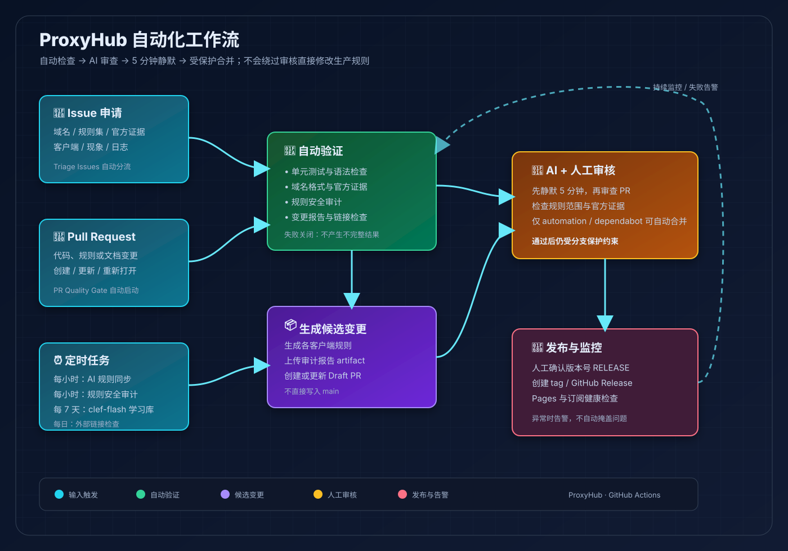
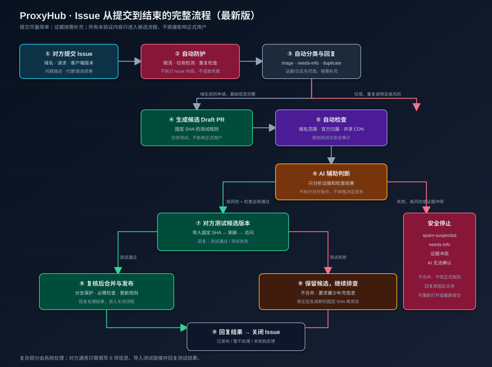

# 🌐 ProxyHub · 全平台代理规则与扩展配置中心

[](https://daey886.github.io/ProxyHub/)
[](https://daey886.github.io/ProxyHub/)
[](LICENSE)

> 一站式开箱即用的分流规则集，专为 **Loon**、**Quantumult X**、**Surge**、**Shadowrocket (小火箭)**、**Clash / Mihomo** 设计。支持 **NSRingo 风格 URL Scheme 一键唤醒导入**。

👉 **一键导入中心（Web Portal）**：**[https://daey886.github.io/ProxyHub/](https://daey886.github.io/ProxyHub/)**

> ## ⚠️ 重要风险声明（请先阅读）
>
> **本项目不保证百分之百避免侧漏，也不保证规则覆盖所有 AI、流媒体或第三方服务。** 本项目主要依据域名规则进行分流，无法完全覆盖未收录的新域名、跨域名调用、共享 CDN、IP 直连、DNS/DoH/DoT 行为、QUIC 或其他非标准连接，以及不同客户端/内核对规则和 DNS 的处理差异。
>
> 规则更新存在延迟或抓取失败的可能；错误的策略组、DNS、代理或客户端配置也可能造成请求直连、误代理、连接失败或账号/隐私风险。**请勿将本项目视为安全、匿名、合规或防封号保证。** 使用前请在目标客户端逐项测试，涉及账号登录、敏感数据、生产环境或合规要求时请采用更严格的网络隔离与独立验证方案；因使用本项目造成的流量泄漏、账号限制、数据暴露、服务中断或其他损失，由使用者自行评估并承担。

---

## ✨ 核心特性

- **🤖 2026 最新海外 AI 矩阵**：聚合收录 OpenAI (ChatGPT/Sora)、Anthropic (Claude)、Google DeepMind (Gemini/Antigravity)、Cursor、Perplexity、Mistral、xAI、Groq 等主流 API，精准走代理。
- **🇨🇳 国产 AI 强制直连 (DIRECT)**：涵盖 DeepSeek、阿里百炼 (DashScope)、智谱 (GLM)、Kimi、豆包、MiniMax、硅基流动等，避免国内模型走代理导致封号或网络劣化。
- **📱 全平台 URL Scheme 一键导入**：直接在 Web 端点击按钮唤起客户端完成安装。
- **🔒 纯净开源**：零私有数据、零内网域名、零无效外链，适合全公开订阅使用。

---

## 📂 仓库目录结构

| 目录 | 适用客户端 | 规则格式 |
| :--- | :--- | :--- |
| [`/loon/`](./loon/) | **Loon** | 远程规则集 (`.list`) |
| [`/qx/`](./qx/) | **Quantumult X** | 远程分流代码片段 (`.snippet`) |
| [`/surge/`](./surge/) | **Surge** | 模块规则集 (`.list`) |
| [`/shadowrocket/`](./shadowrocket/) | **Shadowrocket** | 规则集 (`.list`) |
| [`/clash/`](./clash/) | **Clash / Mihomo** | Rule-Provider (`.yaml`) |
| [`/v2ray/`](./v2ray/) | **V2Ray / Xray / v2rayN / v2rayNG** | 路由域名规则 (`.txt`) |
| [`/ssr/`](./ssr/) | **SSR / Shadowsocks** | ACL 分流规则 (`proxy.acl`) |

---

## ⚙️ 自动化工作流





项目中的 GitHub Actions 已覆盖 PR 质量检查、AI 规则同步、规则安全审计、域名官方证据校验、Issue 分流、外部链接检查、GitHub Pages 健康检查和人工确认发布。自动化只会生成候选变更或 Draft PR，不会绕过审核直接修改生产规则。

- 📘 [查看完整自动化工作流说明](./docs/automation-workflows.md)
- 🛠️ [查看仓库更新手册](./docs/update-guide.md)

## 🛠 客户端手动配置指南

### 1. Quantumult X (`[filter_remote]` 节点)
```ini
https://raw.githubusercontent.com/Daey886/ProxyHub/main/qx/AI-Overseas.snippet, tag=海外AI, force-remote-dns=true, update-interval=3600, opt-parser=false
https://raw.githubusercontent.com/Daey886/ProxyHub/main/qx/AI-Domestic.snippet, tag=国产AI直连, force-remote-dns=false, update-interval=3600, opt-parser=false
https://raw.githubusercontent.com/Daey886/ProxyHub/main/qx/Streaming.snippet, tag=流媒体, force-remote-dns=false, update-interval=3600, opt-parser=false
```

### 2. Loon (`[Remote Rule]` 节点)
```ini
https://raw.githubusercontent.com/Daey886/ProxyHub/main/loon/AI-Overseas.list, policy=海外AI, tag=海外AI, enabled=true
https://raw.githubusercontent.com/Daey886/ProxyHub/main/loon/AI-Domestic.list, policy=DIRECT, tag=国产AI直连, enabled=true
https://raw.githubusercontent.com/Daey886/ProxyHub/main/loon/Streaming.list, policy=流媒体, tag=流媒体, enabled=true
```

### 3. Surge (`[Rule]` 节点)
```ini
RULE-SET,https://raw.githubusercontent.com/Daey886/ProxyHub/main/surge/AI-Overseas.list,海外AI
RULE-SET,https://raw.githubusercontent.com/Daey886/ProxyHub/main/surge/AI-Domestic.list,DIRECT
RULE-SET,https://raw.githubusercontent.com/Daey886/ProxyHub/main/surge/Streaming.list,流媒体
```

### 4. Clash / Mihomo (`rule-providers` 与策略组配置)

#### 方案 A：一键全局扩展脚本 (推荐 · 适用于 Clash Verge Rev / Mihomo Party)
无需手动繁琐修改订阅配置，在客户端的 **订阅扩展 (Script / 预处理)** 中引入或直接粘贴本脚本，即可全自动生成 **海外 AI (美国优先、避开香港/国内节点)**、**国内 AI 直连**、**流媒体** 等专属策略组并注入置顶规则：
- **加速引入链接**：`https://testingcf.jsdelivr.net/gh/Daey886/ProxyHub@main/clash/extension-script.js`
- **GitHub 原生链接**：`https://raw.githubusercontent.com/Daey886/ProxyHub/main/clash/extension-script.js`

#### 方案 B：手动配置 `config.yaml`（策略组 + 地区正则自动分组模板）
> **💡 关键提示**：使用 Mihomo / Clash Meta 核心的 `include-all: true` + `filter` 正则功能，手动写配置也**完全不需要手动一个个填节点名**，直接匹配机场节点自动归类进地区：

```yaml
# 1. 策略组配置 (Proxy Groups)
proxy-groups:
  # --- 业务分流主策略组 ---
  - name: 🤖 海外AI
    type: select
    proxies:
      - ⚡ AI自动优选(避开HK)
      - 🇺🇸 美国节点
      - 🇯🇵 日本节点
      - 🇸🇬 新加坡节点
      - 🇹🇼 台湾节点
      - 🇬🇧 英国节点
      - DIRECT

  - name: ⚡ AI自动优选(避开HK)
    type: url-test
    url: https://api.openai.com/v1/models
    interval: 300
    tolerance: 50
    # 严格排除香港/大陆/澳门，只在美/日/新/英等支持地区测速优选
    filter: "(?i)^(?!.*(香港|HK|Hong Kong|CN|China|中国|澳门|MO)).*(美|US|USA|日|JP|Japan|新|SG|Singapore|英|UK)"

  - name: 🇨🇳 国产AI
    type: select
    proxies:
      - DIRECT
      - 🇭🇰 香港节点
      - 🇯🇵 日本节点
      - 🇺🇸 美国节点

  - name: 🎬 国际流媒体
    type: select
    proxies:
      - 🇭🇰 香港节点
      - 🇹🇼 台湾节点
      - 🇯🇵 日本节点
      - 🇸🇬 新加坡节点
      - 🇺🇸 美国节点

  - name: 💬 社交网络
    type: select
    proxies:
      - 🇭🇰 香港节点
      - 🇯🇵 日本节点
      - 🇸🇬 新加坡节点
      - 🇺🇸 美国节点

  - name: 💻 开发者服务
    type: select
    proxies:
      - 🇭🇰 香港节点
      - 🇯🇵 日本节点
      - 🇸🇬 新加坡节点
      - 🇺🇸 美国节点
      - DIRECT

  - name: 🐟 漏网之鱼
    type: select
    proxies:
      # 兜底默认美国，但允许手动选择香港及其他地区
      - 🇺🇸 美国节点
      - 🇭🇰 香港节点
      - 🇯🇵 日本节点
      - 🇸🇬 新加坡节点
      - 🇹🇼 台湾节点
      - 🇬🇧 英国节点
      - 🌐 其他节点
      - DIRECT

  # --- 地区节点自动归类 (基于 Mihomo / Clash 正则动态分组) ---
  - name: 🇭🇰 香港节点
    type: select
    include-all: true
    filter: "(?i)(香港|HK|Hong Kong|HongKong)"

  - name: 🇯🇵 日本节点
    type: select
    include-all: true
    filter: "(?i)(日本|JP|Japan|Tokyo|Osaka)"

  - name: 🇺🇸 美国节点
    type: select
    include-all: true
    filter: "(?i)(美国|US|USA|United States|America)"

  - name: 🇸🇬 新加坡节点
    type: select
    include-all: true
    filter: "(?i)(新加坡|SG|Singapore|狮城)"

  - name: 🇹🇼 台湾节点
    type: select
    include-all: true
    filter: "(?i)(台湾|TW|Taiwan|Taipei)"

  - name: 🇬🇧 英国节点
    type: select
    include-all: true
    filter: "(?i)(英国|UK|United Kingdom|London)"

  - name: 🌐 其他节点
    type: select
    include-all: true
    filter: "(?i)^(?!.*(香港|HK|Hong Kong|HongKong|日本|JP|Japan|Tokyo|Osaka|美国|US|USA|United States|America|新加坡|SG|Singapore|狮城|台湾|TW|Taiwan|Taipei|英国|UK|United Kingdom|London)).*"

# 2. 远程规则集配置 (Rule Providers - 默认走 CDN 镜像加速)
rule-providers:
  ai-domestic:
    type: http
    behavior: domain
    url: "https://testingcf.jsdelivr.net/gh/Daey886/ProxyHub@main/clash/AI-Domestic.yaml"
    path: ./ruleset/ai-domestic.yaml
    interval: 3600

  ai-overseas:
    type: http
    behavior: domain
    url: "https://testingcf.jsdelivr.net/gh/Daey886/ProxyHub@main/clash/AI-Overseas.yaml"
    path: ./ruleset/ai-overseas.yaml
    interval: 3600

  streaming:
    type: http
    behavior: domain
    url: "https://testingcf.jsdelivr.net/gh/Daey886/ProxyHub@main/clash/Streaming.yaml"
    path: ./ruleset/streaming.yaml
    interval: 3600

  social:
    type: http
    behavior: domain
    url: "https://testingcf.jsdelivr.net/gh/Daey886/ProxyHub@main/clash/Social.yaml"
    path: ./ruleset/social.yaml
    interval: 3600

  development:
    type: http
    behavior: domain
    url: "https://testingcf.jsdelivr.net/gh/Daey886/ProxyHub@main/clash/Development.yaml"
    path: ./ruleset/development.yaml
    interval: 3600

  advertising:
    type: http
    behavior: domain
    url: "https://testingcf.jsdelivr.net/gh/Daey886/ProxyHub@main/clash/Advertising.yaml"
    path: ./ruleset/advertising.yaml
    interval: 3600

# 3. 路由规则匹配 (Rules)
rules:
  - RULE-SET,advertising,REJECT
  - RULE-SET,ai-domestic,🇨🇳 国产AI
  - RULE-SET,ai-overseas,🤖 海外AI
  - RULE-SET,streaming,🎬 国际流媒体
  - RULE-SET,social,💬 社交网络
  - RULE-SET,development,💻 开发者服务
  - GEOIP,CN,DIRECT
  - MATCH,🐟 漏网之鱼
```

### 5. V2Ray / Xray (v2rayN / v2rayNG / 路由设置)

在 v2rayN **设置 ➔ 路由设置 ➔ 添加规则** 中，可直接粘贴或远程引入该规则文件中的域名：
- **海外 AI (走代理)**：`https://raw.githubusercontent.com/Daey886/ProxyHub/main/v2ray/AI-Overseas.txt` (国内加速: `https://testingcf.jsdelivr.net/gh/Daey886/ProxyHub@main/v2ray/AI-Overseas.txt`)
- **国内 AI (直连 direct)**：`https://raw.githubusercontent.com/Daey886/ProxyHub/main/v2ray/AI-Domestic.txt` (国内加速: `https://testingcf.jsdelivr.net/gh/Daey886/ProxyHub@main/v2ray/AI-Domestic.txt`)

---

## 📝 平台收录与动态更新日志 (Changelog)

> 每次 GitHub Actions 自动爬取到新 AI 平台或规则更新时，均会自动记录在此：

| 日期 | 变动类型 | 涉及平台 / 厂商 | 分流策略 | 详细说明 |
| :--- | :--- | :--- | :--- | :--- |
| `2026-10-19` | 🤖 **自动同步** | anthropic, baai, bytedance, cohere, deepseek, fireworks, google, meta, minimax, mistral, moonshot, openai, openrouter, perplexity, qwen, stepfun, tencent | `海外AI` / `DIRECT` | 收录 17 个匹配平台，新增 12 个域名，重复域名已去重 |
| `2026-10-18` | 🤖 **自动同步** | anthropic, baai, bytedance, cohere, deepseek, fireworks, google, meta, minimax, mistral, moonshot, openai, openrouter, perplexity, qwen, stepfun, tencent | `海外AI` / `DIRECT` | 收录 17 个匹配平台，新增 0 个域名，重复域名已去重 |
| `2026-10-18` | 🚀 **初始化上线** | LMSYS & OpenRouter 头部全矩阵 | `海外AI` / `DIRECT` | 自动抓取并初始化收录 89+ 全球 AI 活跃机构与提供商 |
| `2026-10-18` | 🤖 **AI 矩阵扩充** | OpenAI, Claude, Antigravity, Cursor, Perplexity 等 | `海外AI (代理)` | 覆盖 2026 最新代码/大模型 API，并加入规避 HK 提示 |
| `2026-10-18` | 🇨🇳 **国产大模型** | DeepSeek, 通义千问, 智谱GLM, Kimi, 豆包, MiniMax 等 | `DIRECT (直连)` | 强制直连保证响应延迟，防止代理出口风控与误伤 |
| `2026-10-18` | 🌐 **Web Portal** | Loon, Surge, QX, Shadowrocket, Clash | `多端一键导入` | 部署 GitHub Pages 静态安装主页，实现 NSRingo 级一键唤醒 |

---

## 🔧 规则维护与自动同步 (Maintainer Guide)

规则由 `scripts/auto_update_ai.py` 统一生成，六个客户端（Loon / Surge / Shadowrocket /
QuantumultX / Clash / V2Ray）共享同一份域名集合，因此不会出现"某端多一条"的漂移。

**域名来源必须可追溯**：`scripts/ai_rules_catalog.py` 中每一个域名都要在
`OFFICIAL_SOURCES` 里写明官方出处（厂商 API 主机或官方文档）。没有出处的域名不会被生成，
更不会靠"猜"补一个看着像的域名。

```bash
python3 scripts/auto_update_ai.py --dry-run     # 只看将要改什么，不落盘
python3 scripts/auto_update_ai.py --check       # CI 用：规则已过期则退出码 1
python3 scripts/auto_update_ai.py               # 正式生成
python3 -m unittest discover -s tests -v        # 测试套件
```

**安全约束（已由测试覆盖）**

- **抓取失败绝不写文件**：任一官方源不可达时整体中止并返回退出码 `2`，所有规则文件保持原样；
  若只想在离线环境修复规则，显式加 `--allow-partial-fetch`，此时不会写入 Changelog。
- **手工域名永不丢失**：生成前会先把仓库中已有域名全部并入，再叠加目录；手写条目只会被保留。
- **共享 CDN 根域名会被拦截**：`googleapis.com`、`gstatic.com`、`googleusercontent.com`
  这类后缀会把无关 Google 流量一并代理并导致登录异常，因此只保留经审计的具体主机
  （如 `generativelanguage.googleapis.com`），未审计的子域名会让整次运行失败而不是被静默写入。
- **多端一致性校验**：写入后重新解析六种格式，逐条比对域名集合、排序、数量与文件头计数，
  不一致则自动回滚本次全部改动。
- **CI 只开 PR 不推主干**：`.github/workflows/sync-ai-leaderboard.yml` 以 `contents: read`
  运行，改动提交到 `automation/sync-ai-rules` 分支并创建 PR，由人审后合并。

> 修复"海外 AI 被误判直连"这类问题时，请改 `ai_rules_catalog.py` 的分流分类，
> 而不是手改生成出来的 `.list` / `.yaml` —— 后者会在下次自动同步时被覆盖。

---

## 📄 License
MIT © [Daey886](https://github.com/Daey886)
